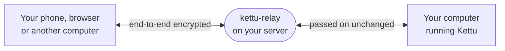

<div align="center">

<h1>
  <picture>
    <source media="(prefers-color-scheme: dark)" srcset="./assets/lockup-horizontal-dark.svg">
    
  </picture>
  <br>
  Relay
</h1>

[](https://github.com/KettuAI/relay/actions/workflows/ci.yml)
[](#run-it)
[](./go.mod)
[](./LICENSE)

<h3>Your own relay for Kettu.</h3>

Reach the computers that run [Kettu](https://github.com/KettuAI/Kettu) from any network, through a server you run, without a Kettu account.

[**Releases**](https://github.com/KettuAI/relay/releases) · [Kettu](https://github.com/KettuAI/Kettu) · [Protocol](./PROTOCOL.md) · [Changelog](./CHANGELOG.md) · [Security](./SECURITY.md) · [简体中文](./README.zh-CN.md)

</div>



> [!NOTE]
> kettu-relay is an early preview. It needs a version of Kettu that offers **Your own relay** under **Settings › Remote access › Relay**.

## Features

- **Your server, your relay**: your phone, a browser or another computer reaches your Kettu computers from any network, with no VPN, no open port on those computers and no Kettu account.
- **Sees nothing inside**: the relay joins a device to a computer, then passes Kettu's end-to-end encrypted channel unchanged. It never sees your sessions, files or keys.
- **One small program**: a single binary with nothing else to install, or one Docker image.
- **Certificates taken care of**: Let's Encrypt for a domain, your own proxy in front, or a self-signed certificate that Kettu pins when you have an IP address alone.
- **One key, for your computers only**: only computers that have the relay's access key sign in. Devices bring no key; each computer decides which devices it talks to, inside the encrypted channel. Losing a phone never means changing the key.
- **Web client included**: the relay serves Kettu's web client at its own address, checked against the checksums of Kettu's release.
- **Hard to abuse**: limits on connections, per address and in all, keep strangers who know a computer's id from filling its slots or the relay.
- **Open protocol**: relay protocol 1 is in [PROTOCOL.md](./PROTOCOL.md), and the package `github.com/KettuAI/relay/relay` is the relay itself, for programs that build on it.

## Run it

Point a domain at your server, open ports 80 and 443, and run:

```sh
docker run -d --name kettu-relay --restart unless-stopped \
  -p 80:80 -p 443:443 \
  -e KETTU_RELAY_DOMAIN=relay.example.com \
  -v kettu-relay:/data \
  ghcr.io/kettuai/relay:latest
```

The relay gets and renews its certificate from Let's Encrypt by itself. The image (amd64 and Arm) runs as an unprivileged user and writes only to `/data`. Port 80 is only for Let's Encrypt's challenge and the redirect to https; with `KETTU_RELAY_HTTP_LISTEN=off` the relay answers the challenge on 443 alone.

Then print the relay's link, which holds its address and access key:

```sh
docker exec kettu-relay kettu-relay link
```

```
https://relay.example.com#key=krk_...
```

> [!IMPORTANT]
> Anyone who has the link can sign computers in to your relay. Keep it to yourself, and if it ever ends up in a log or a chat you do not control, run `kettu-relay key reset` and paste the new link into each computer.

The first start prints the full link once; later starts log the address with the key masked (`krk_…3hT9`). Running `kettu-relay link` before the first start keeps the key out of the logs altogether.

### Other ways to run it

<details>
<summary><b>Behind your own proxy</b></summary>

If Caddy, nginx or a tunnel already serves https on the server, run the relay on a local port and tell it the address people use:

```sh
KETTU_RELAY_URL=https://relay.example.com kettu-relay
```

It listens on `127.0.0.1:8798` (change it with `KETTU_RELAY_LISTEN`). With Caddy:

```
relay.example.com {
	reverse_proxy 127.0.0.1:8798
}
```

nginx needs WebSocket upgrades passed on:

```nginx
location / {
    proxy_pass http://127.0.0.1:8798;
    proxy_http_version 1.1;
    proxy_set_header Upgrade $http_upgrade;
    proxy_set_header Connection "upgrade";
    proxy_set_header Host $host;
    proxy_set_header X-Forwarded-For $proxy_add_x_forwarded_for;
    proxy_read_timeout 1h;
}
```

The relay takes the client's address from `X-Forwarded-For` only when the request comes from a trusted proxy: by default loopback addresses, or the addresses and CIDR ranges in `KETTU_RELAY_TRUSTED_PROXIES`. Behind a proxy the relay also takes connections only from those addresses and refuses the rest, since its own port serves plain http.

In Docker, set `KETTU_RELAY_TRUSTED_PROXIES` to your proxy's network and `KETTU_RELAY_LISTEN=:8798`, and keep that port unpublished, reachable only by the proxy. The relay notes this in its log whenever it listens on an address other than loopback.

</details>

<details>
<summary><b>On an IP address alone</b></summary>

Without a domain, the relay makes its own certificate and prints its pin, the SHA-256 of its public key, which goes into the link:

```sh
docker run -d --name kettu-relay --restart unless-stopped \
  -p 443:443 \
  -e KETTU_RELAY_IP=203.0.113.7 \
  -v kettu-relay:/data \
  ghcr.io/kettuai/relay:latest
```

The link then reads `https://203.0.113.7#key=krk_...&pin=...`, and Kettu trusts the relay by that pin instead of a certificate authority. The desktop app, the daemon and the iPhone app can use such a relay. A browser cannot pin a certificate, so it needs a relay with a domain, and the relay serves no web client on an IP address.

</details>

<details>
<summary><b>With systemd</b></summary>

Download the archive for your system from the [releases](https://github.com/KettuAI/relay/releases), check it against `SHA256SUMS`, unpack it, and use the unit in [`deploy/kettu-relay.service`](./deploy/kettu-relay.service), whose header lists the steps. Each archive holds the program, its license and `THIRD_PARTY_NOTICES.txt`.

Run the relay's commands as its user, so they read the same files:

```sh
sudo -u kettu-relay sh -c 'set -a; . /etc/kettu-relay.env; kettu-relay link'
```

</details>

<details>
<summary><b>On one computer, to try it</b></summary>

With none of `KETTU_RELAY_DOMAIN`, `KETTU_RELAY_URL` and `KETTU_RELAY_IP` set, the relay serves plain http on `127.0.0.1:8798` only, for trying it out with Kettu on the same computer:

```sh
go run github.com/KettuAI/relay/cmd/kettu-relay@latest
```

Plain http is never served on any other address, since the access key crosses the network.

</details>

## Connect Kettu

- **On each computer**: in Kettu, open **Settings › Remote access › Relay**, choose **Your own relay**, paste the link and choose **Use this relay**. Kettu checks the relay and the key before it switches.
- **On a server running Kettu's daemon**: `kettu relay use '<link>'`, or set `KETTU_RELAY_LINK` to the link, which is checked and used at every start. `kettu relay status` shows the relay in use.
- **Your devices**: add them as usual with **Add device**; the pairing code carries your relay, never its key. Devices online when you switch move over at once, and they need no Kettu account.

A computer uses one relay at a time. To go back, choose **Kettu relay** or **No relay** in the same place.

## Commands

| Command | What it does |
| --- | --- |
| `kettu-relay` | Runs the relay. The first start prints its link; later ones log it with the key masked. |
| `kettu-relay link` | Prints the full link, making the access key if there is none yet. |
| `kettu-relay key reset` | Makes a new access key. A running relay cuts off the computers signed in with the old key within a few seconds; paste the new link into each. |
| `kettu-relay version` | Prints the version. |

In Docker, run them in the container: `docker exec kettu-relay kettu-relay link`.

## Settings

All settings are environment variables. You need at most one of the first three.

| Variable | What it does |
| --- | --- |
| `KETTU_RELAY_DOMAIN` | Serve https for this domain with a Let's Encrypt certificate. |
| `KETTU_RELAY_URL` | Serve plain http behind your proxy; this is the https address people use. |
| `KETTU_RELAY_IP` | Serve https at this IP address with a self-signed certificate. |

<details>
<summary><b>All settings</b></summary>

| Variable | Default | Meaning |
| --- | --- | --- |
| `KETTU_RELAY_LISTEN` | `:443`, or `127.0.0.1:8798` behind a proxy or on one computer | The address to listen on. With a domain or an IP, a port other than 443 becomes part of the relay's address. |
| `KETTU_RELAY_HTTP_LISTEN` | `:80` | With a domain: Let's Encrypt's http challenge and the redirect to https. `off` for none. |
| `KETTU_RELAY_DATA` | `/data` in Docker, else the user's config directory | Where the key, certificates and web client are kept. |
| `KETTU_RELAY_ACCESS_KEY` | | The access key, instead of the key file. It is never printed in full, and `kettu-relay key reset` cannot change it. |
| `KETTU_RELAY_ACME_EMAIL` | | An address Let's Encrypt may write to about the certificate. |
| `KETTU_RELAY_TRUSTED_PROXIES` | loopback behind a proxy, else none | Addresses and CIDR ranges whose `X-Forwarded-For` is believed. |
| `KETTU_RELAY_WEB` | `on` | `off` stops serving the web client. |
| `KETTU_RELAY_CONNECTIONS_PER_MINUTE` | `120` | New connections a minute from one address. |
| `KETTU_RELAY_DEVICES_PER_MINUTE` | `60` | New device connections a minute to one computer from one address. |
| `KETTU_RELAY_MAX_CONNECTIONS` | `4096` | Connections the relay holds at once; past it new ones are refused with 503. |
| `KETTU_RELAY_MAX_CONNECTIONS_PER_ADDRESS` | `64` | Connections one address holds at once; past it new ones are refused with 429. |
| `KETTU_RELAY_MAX_PENDING_DEVICES` | `16` | Devices waiting to connect to one computer; past it the one that waited longest is let go. |
| `KETTU_RELAY_JOIN_TIMEOUT` | `10` | Seconds a connected device has before the computer answers it, else both sides are closed. |

Each computer may have 16 devices connected at once, a message may be up to 64 KiB, and a computer or device has 10 seconds to sign in or connect, as the protocol sets. Devices bring no key, so these limits are what keep strangers who know a computer's id from filling its slots or the relay: the slots of a computer's real devices are not taken by connections that never pair.

</details>

## What the relay sees

- **What it sees**: the address a connection comes from, a computer's relay id (derived from the computer's public key), and the size and timing of the encrypted messages it passes.
- **What it does not**: what is in them. The channel is encrypted between the computer and the device, and the computer decides which devices it talks to.
- **What it keeps**: nothing about connections on disk, and no ids or addresses in its log. On disk it keeps only its access key, its certificates (with the Let's Encrypt account) and a copy of the web client, in a data directory it keeps at mode 0700. It refuses to start when the key file or a private key can be read by other users, or when the data directory belongs to another user.

## The web client

So that a browser can reach your computers through your relay, the relay serves Kettu's web client at its own address. When it starts, and every day after, it downloads the web client built for relays from the latest [Kettu release](https://github.com/KettuAI/Kettu/releases), checks it against the release's SHA-256 checksums and unpacks it into its data directory. When a download fails it keeps serving the copy it has; before it ever got one, it serves none and says so in its log.

A computer's **Add device** then gives browsers a link to `https://<your relay>/pair#...`. The page talks only to its own origin, the relay, and pairs and runs sessions like the hosted web client.

Whoever runs a relay can change the pages it serves, so a browser that opens the web client through a relay trusts the relay's operator; on your own relay, that is you. The desktop and iPhone apps do not depend on it.

## Versions

kettu-relay follows [semantic versioning](https://semver.org): fixes are patch versions, new features minor versions, and anything taken away a major version. It serves relay protocol 1, described in [PROTOCOL.md](./PROTOCOL.md), which only grows. See [CHANGELOG.md](./CHANGELOG.md) for each version.

## Build from source

```sh
go build ./cmd/kettu-relay
go test -race ./...
```

The relay uses Go's standard library, `golang.org/x/crypto` for Let's Encrypt and `github.com/coder/websocket`. Their licenses are in [`THIRD_PARTY_NOTICES.txt`](./THIRD_PARTY_NOTICES.txt), made by `scripts/notices.sh`. The package `github.com/KettuAI/relay/relay` is the relay itself, with who may sign in left to an `Admission`, so other programs can build on it.

## Feedback

Open an [issue](https://github.com/KettuAI/relay/issues) in any language. Security problems go through [SECURITY.md](./SECURITY.md).

## License

[AGPL-3.0](./LICENSE).
